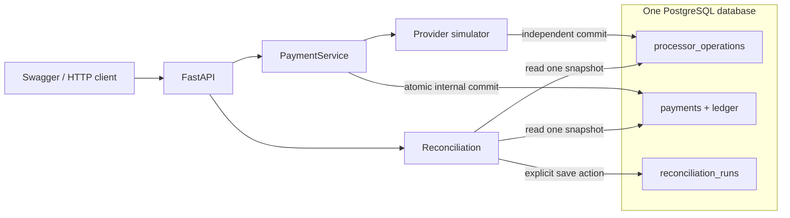

# Payment Reliability & Reconciliation Simulator

A Python backend for testing payment retries, lost responses, and reconciliation.
The simulated provider saves its results separately from the application's
payment records. If a response is lost, the application can recover the result
without submitting another charge. No real money is processed.

Built with Python 3.12, FastAPI, SQLAlchemy, PostgreSQL, and Pytest. Docker Compose
runs PostgreSQL; the API runs in a local Python virtual environment.

The [demo](docs/demo.md) walks through a payment timeout and recovery. The
[engineering notes](docs/engineering-notes.md) cover the design and database
upgrades.

Install Python 3.12 and start Docker Desktop, then run these commands from the
repository root:

```bash
python3.12 -m venv .venv
source .venv/bin/activate
python -m pip install -r requirements-dev.txt
docker compose up -d --wait db
python -m payment_reliability.init_database
python -m uvicorn payment_reliability.main:app --reload
```

Open [Swagger](http://127.0.0.1:8000/docs) to send requests. If Docker is
missing from your Mac terminal's PATH, run
`export PATH="$HOME/.docker/bin:$PATH"` first. Start and initialize the database
before starting the API.

The initialization command creates all tables in a fresh database. It preserves
existing rows and does not alter existing tables or fill in missing financial
history. Older databases may need the
[processor transaction ID migration](docs/engineering-notes.md). Use a new
payment key when starting the demo.

Requests follow this flow:



The main design decisions are:

- PostgreSQL reserves the idempotency key before the provider is called. A retry
  of a completed payment returns its saved result. A changed amount or a payment
  still in `processing` returns `409`.
- The provider saves its result before raising a simulated timeout. That result
  survives an API restart, even when the internal payment is still `processing`.
- A successful payment and its balanced ledger posting commit in one database
  transaction. If a ledger write fails, the success update rolls back too.
  A unique payment ID on the posting prevents duplicate postings.
- Recovery reads the provider's saved receipt and checks the payment ID, amount,
  currency, and transaction reference before saving the result.
- Reconciliation compares records from one read-only snapshot. Each saved check
  gets a new audit record, preserving earlier results and their observation times.

| Action | Endpoint | Expected response |
|---|---|---|
| Create or retry a payment | `POST /payments` | `201` with the recorded result; conflicts return `409`. |
| Recover a payment | `POST /payments/recover` | `200` with its current state. |
| Check payment records | `GET /payments/reconciliation` | `200` with the report and any findings. |
| Save a reconciliation report | `POST /payments/reconciliation/runs` | `201` with a new run ID, observation time, and report. |
| Get saved reports | `GET /payments/reconciliation/runs` | `200` with the payment's report history. |

Every endpoint uses an `Idempotency-Key` header to identify the payment. Only
`POST /payments` takes a JSON body, for example
`{"amount":"25.00","currency":"USD"}`. On the saved-run endpoints, the header
selects the payment. Each POST saves another check, even if the request is
repeated. Saving a report does not submit another charge.

To try the timeout scenario, stop any running API and restart it with:

```bash
SIMULATE_LOST_RESPONSE=1 SIMULATE_DECLINES=0 python -m uvicorn payment_reliability.main:app --reload
```

A new payment returns `503` after the provider saves its result. A matching
retry returns `409`. Restart the API, recover with the original key, then inspect
the ledger and saved reports. The [demo guide](docs/demo.md) includes the commands,
expected responses, and a query to check that only one charge was recorded.

With PostgreSQL running and initialized, run the tests:

```bash
python -m pytest -q
```

The tests cover concurrent requests, lost responses, rollback after failed
ledger writes, reconciliation discrepancies, and saved report history.
Integration tests clean up their own records or temporary schemas. The comparison
tests can run without PostgreSQL:

```bash
python -m pytest tests/test_reconciliation.py -q
```

The [CI workflow](.github/workflows/tests.yml) is configured to initialize
PostgreSQL 18.6 and run the tests with Python 3.12 on pushes and pull requests.

The MVP supports USD, single-step simulated charges, success and decline
results, and manual recovery. Reconciliation checks one successful payment at a
time. Authorization, capture, voids, refunds, batch reconciliation, and automatic
repairs are outside the current scope.

The provider and application share one PostgreSQL database, which allows
reconciliation to read both from the same snapshot. The application only inserts
or reads ledger and audit records. Posting validation and database transactions
enforce the accounting rules, with database constraints checking uniqueness and
individual rows.

The interface is Swagger and the HTTP API. A dashboard, authentication, and
production deployment are outside the MVP. Older development records may have
missing provider or ledger history; reconciliation reports those gaps without
changing the records.
