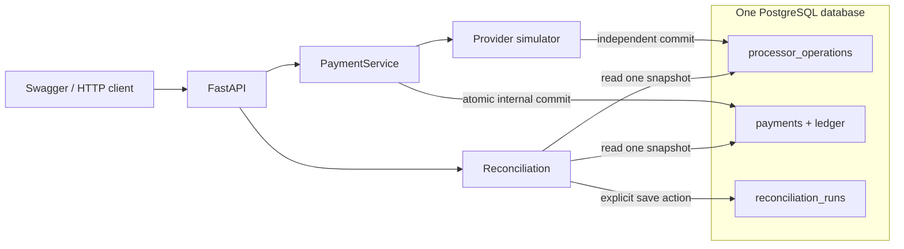

# Payment Reliability & Reconciliation Simulator

A Python backend for testing payment retries, lost responses, and reconciliation.
Reliable payment handling distinguishes failed requests from unconfirmed outcomes,
avoiding duplicate charges and inconsistent records. The provider is simulated;
no real money is processed.

## Quick Demo

Follow the [demo guide](docs/demo.md), or explore
[FastAPI Swagger](http://127.0.0.1:8000/docs) after [local setup](#local-setup).

In the timeout scenario, the provider saves a successful simulated charge, but
the API returns `503` and leaves the payment `processing`. A matching retry
returns `409`. The demo covers an API restart, recovery with the original key,
and verification of one charge.

## Key Engineering Features

- **PostgreSQL-backed idempotency:** A unique key is reserved before calling the
  provider. Completed matching retries replay saved results; changed amounts or
  unresolved payments return `409`.
- **Persistent provider records:** Outcomes commit to `processor_operations` in a
  separate transaction, survive API restarts, and remain independent of internal
  payment status.
- **Recovery after lost responses:** Recovery reads the saved receipt without
  another charge, validating payment ID, amount, currency, and consistency between
  outcome and transaction reference. Missing confirmation leaves `processing`;
  repeated recovery preserves completed results.
- **Atomic payment and ledger updates:** Success, processor reference, and a
  balanced posting commit together: debit processor clearing, credit merchant
  payable. A ledger write failure rolls back internal success while preserving
  the independent provider record.
- **Duplicate-posting prevention:** Uniqueness constraints allow one posting per
  payment and one entry per accounting side. Posting validation and a shared
  transaction enforce the complete balanced pair; database constraints check
  individual rows.
- **Read-only reconciliation and historical reports:** Checks compare payment,
  provider, and ledger records in one `REPEATABLE READ, READ ONLY` snapshot.
  Explicit saves append audit records in a separate transaction, preserving
  reports and observation times without replacing earlier findings or repairing
  financial records.

## Architecture Diagram



## API Endpoints

| Action | Endpoint | Expected response |
|---|---|---|
| Create or retry a payment | `POST /payments` | `201`: saved success or decline; `409`: conflict. |
| Recover a payment | `POST /payments/recover` | `200`: current payment state. |
| Check payment records | `GET /payments/reconciliation` | `200`: report and findings. |
| Save a reconciliation report | `POST /payments/reconciliation/runs` | `201`: run ID, observation time, and report. |
| Get saved reports | `GET /payments/reconciliation/runs` | `200`: saved report history. |

Every endpoint requires an `Idempotency-Key` header identifying the payment. Only
`POST /payments` takes JSON: `{"amount":"25.00","currency":"USD"}`.
Its `201` records an attempt; `status` describes success or decline.
For saved runs, the key selects the payment; each POST appends another check.
GET requests save nothing. A `200` reconciliation report can contain discrepancies.

## Tech Stack

Python 3.12, FastAPI, Pydantic, SQLAlchemy, PostgreSQL, and Pytest. PostgreSQL runs
in Docker Compose; the API runs in a local virtual environment.

## Local Setup

Install Python 3.12, start Docker Desktop, and run from the repository root:

```bash
python3.12 -m venv .venv
source .venv/bin/activate
python -m pip install -r requirements-dev.txt
docker compose up -d --wait db
python -m payment_reliability.init_database
python -m uvicorn payment_reliability.main:app --reload
```

Use fresh keys for demo payments. See the engineering notes for
[database upgrades](docs/engineering-notes.md#database-initialization-and-upgrades)
and [Mac Docker PATH troubleshooting](docs/engineering-notes.md#mac-docker-path-troubleshooting).

## Testing and CI

With PostgreSQL running and initialized:

```bash
python -m pytest -q
```

Tests cover concurrent requests, lost responses, ledger rollback, reconciliation
discrepancies, and preserved report history. Comparison tests run without PostgreSQL:

```bash
python -m pytest tests/test_reconciliation.py -q
```

The [GitHub Actions workflow](.github/workflows/tests.yml) initializes
PostgreSQL 18.6 and runs Pytest with Python 3.12 on pushes and pull requests.

## Limitations

The MVP supports USD, single-step simulated charges, success, decline, and manual
recovery. Reconciliation checks one successful payment at a time.
Authorization, capture, voids, refunds, batch reconciliation, and automatic
repairs are outside scope.

Provider and application records share one PostgreSQL database, enabling a shared
reconciliation snapshot. This local simulation does not implement real distributed
payment infrastructure or a production-ready processor. The interface is Swagger
and HTTP; dashboard, authentication, and production deployment are outside scope.

Application code only inserts or reads ledger and audit records. Older development
records may lack provider or ledger history; reconciliation reports gaps without
repairing records or inventing history.

## Additional Documentation

- [Demo guide](docs/demo.md): commands, responses, and record verification.
- [Engineering notes](docs/engineering-notes.md): transactions, recovery semantics,
  reconciliation, database upgrades, and troubleshooting.
